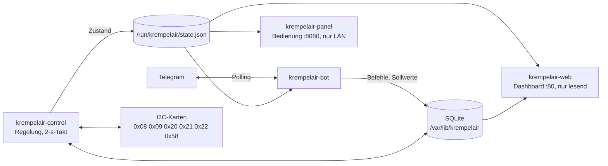

# Krempelair

Regelung, Telegram-Bot und Dashboard für die Lüftungsanlage im Krempel
(Raspberry Pi 4, I2C-Karten, Zu- und Abluftventilator, Kreuz-Wärmetauscher
mit Bypassklappe, Heizregister mit Ventil).



Nur die Regelung greift auf die Hardware zu. Bot, Dashboard und Panel laufen
als eigene Dienste: fällt einer aus, regelt die Anlage weiter.

Version 2 ist eine Neufassung der früheren Regelung (Flask-Weboberfläche in
diesem Repository bis 2021, danach Telegram-Bot). Die alte Fassung steht in
der Git-Geschichte.

## Was die Anlage kann

- Zulufttemperatur mit PID-Regler und Vorsteuerung über ein Anlagenmodell
  (Wärmetauscher zuerst, dann Heizregister), Anti-Windup, 2-s-Takt
- Kälterückgewinnung über den Tauscher, wenn die Aussenluft wärmer ist als
  die Abluft; freie Kühlung über den Bypass
- Nachtauskühlung per Telegram für 48 h: die Lüftung schaltet sich selbst ein
- Frostschutz hat immer Vorrang
- Laufzeitbegrenzung: nach 36 h ununterbrochenem Lauf schaltet die Lüftung aus
- Handbetrieb für WRG-Klappe und Heizventil (1–8 h)
- Telegram-Bot mit Passwort, Dashboard mit Anlagenschema und Highcharts-Verläufen,
  Bedien-Panel mit Anmeldung nur im LAN
- Sprungversuch und Reglerauslegung nach SIMC (`steptest`, `identify`)

## Dokumentation

| Dokument | Inhalt |
|---|---|
| [docs/Anleitung-Lueftung-Krempel.pdf](docs/Anleitung-Lueftung-Krempel.pdf) | Bedienungsanleitung: Telegram, Dashboard, Web-Panel (Quelle: `docs/anleitung/anleitung.html`) |
| [docs/regelung.md](docs/regelung.md) | Betriebsfälle, PID mit Vorsteuerung, KRG, Nachtauskühlung, Sprungversuch |
| [docs/betrieb.md](docs/betrieb.md) | Dienste, Telegram-Befehle, Dashboard, Dateien, Update und Rückfall |

Fernzugang, Sicherung und der Ersatz der SD-Karte sind in einer privaten
Fassung dieses Projekts beschrieben; dort liegt auch die Konfiguration des
Rückkanals, ohne die `deploy/install.sh` nicht vollständig durchläuft.

## Ordner

| Ordner | Inhalt |
|---|---|
| `krempelair/` | Programm (Python 3.7+, nur Standardbibliothek und `smbus`) |
| `krempelair/web_static/` | Dashboard; `vendor/` enthält Highcharts Stock 12.1.2 |
| `tests/` | Unit- und Integrationstests mit simulierter Anlage |
| `deploy/` | systemd-Dienste, Konfiguration, Installation, Rückfall, Sicherung |

## Schnellstart

```bash
python3 -m krempelair simulate --port 8091                   # Simulator + Dashboard
PYTHONPATH=.:tests python3 -m unittest discover -s tests     # Tests
```

## Lizenz

AGPL-3.0, siehe [LICENSE](LICENSE). Highcharts (`krempelair/web_static/vendor/`)
hat eine eigene Lizenz und ist nur für nicht-kommerzielle Nutzung kostenlos.
